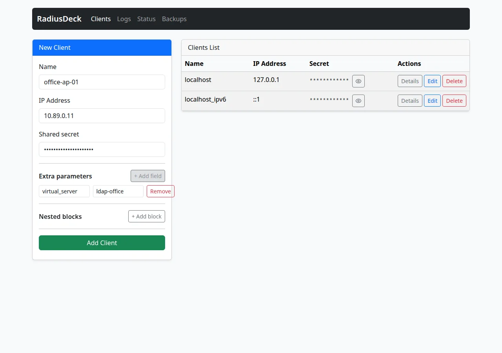
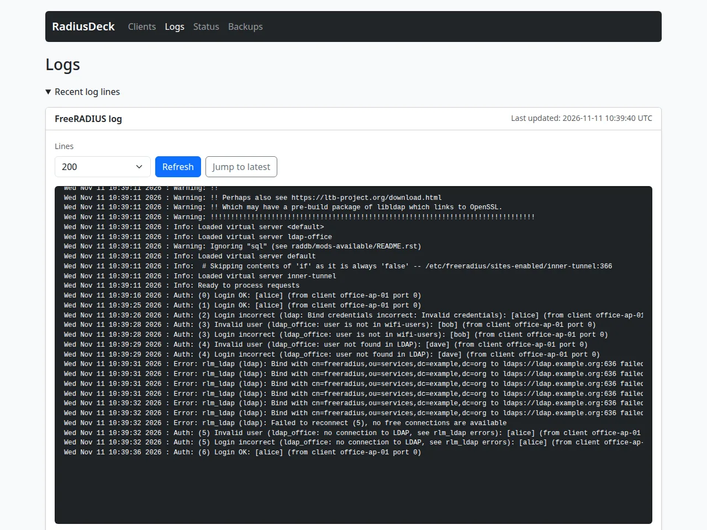

**Short answer:** Enable the FreeRADIUS `ldap` module with a read-only
service account and `ldaps://`, and call it only from a separate virtual
server. A NAS whose `clients.conf` entry has `virtual_server = ldap-office`
checks users in LDAP and requires membership in the group `wifi-users`.
All other NAS keep working with their old users. The password is checked by
an LDAP bind, so `ldap-office` accepts only PAP requests.

In this lab, `radtest` plays the NAS. Setting up Wi-Fi with 802.1X on an
access point is outside this guide.

* TOC
{:toc}

## Tested with

- FreeRADIUS 3.2.10, image
  `freeradius/freeradius-server:3.2.10@sha256:cc7fd136e7b03e7b332d94297530318e824a4ecfedbce54562cced723e71e812`.
- OpenLDAP 2.6.15 from the previous guide,
  [OpenLDAP in Docker](/blog/openldap-docker/).
- RadiusDeck 0.1.2, image
  `ghcr.io/radiusdeck/radiusdeck:0.1.2@sha256:9e59d023ced94921711958fc430df6e3017f37c02b8d44e62866d9980ebf8346`.
- Docker 29.9.3 on Ubuntu 24.04.

This is a test lab. The domain `example.org`, the addresses, the passwords
and the shared secrets are examples.

## What you will build

Start where the OpenLDAP guide ends: the container `openldap` on the network
`ldap-net` answers `ldaps://ldap.example.org`, the test CA is in
`ca/ca_cert.pem`, and the user `alice` exists. Run all commands below from
the same directory.

This guide adds a second network, `radius-net`, for FreeRADIUS, RadiusDeck
and two test NAS. FreeRADIUS joins both networks:

```text
office-ap-01     10.89.0.11 -> freeradius 10.89.0.2 -> virtual server ldap-office -> ldaps://ldap.example.org
office-switch-01 10.89.0.12 -> freeradius 10.89.0.2 -> virtual server default     -> local users
radiusdeck       10.89.0.3  -> edits clients.conf, shows radius.log
```

`radius-net` has an explicit subnet because the test NAS need fixed
addresses, and Docker assigns `--ip` only in such a network. If
`10.89.0.0/24` is in use on your machine, pick another free private range
and change the addresses everywhere.

Pin the two new images:

```bash
FR=freeradius/freeradius-server:3.2.10@sha256:cc7fd136e7b03e7b332d94297530318e824a4ecfedbce54562cced723e71e812
RD=ghcr.io/radiusdeck/radiusdeck:0.1.2@sha256:9e59d023ced94921711958fc430df6e3017f37c02b8d44e62866d9980ebf8346
```

## Prepare the directory

FreeRADIUS needs an account that can find users and read their groups. The
user `bob` will show what happens to a user outside the group.

The service account uses the object class `simpleSecurityObject`, which
needs a password when the entry is created. This server stores a password
from `ldapadd` as it is, so make the hash first with `slappasswd` inside the
container, in the server's own scheme:

```bash
export LDAPTLS_CACERT="$PWD/ca/ca_cert.pem"
HASH=$(docker exec openldap slappasswd -o module-load=pw-pbkdf2.so \
  -h '{PBKDF2-SHA512}' -s radius-bind-pass-change-me)

cat > radius.ldif <<EOF
dn: ou=services,dc=example,dc=org
objectClass: organizationalUnit
ou: services

dn: cn=freeradius,ou=services,dc=example,dc=org
objectClass: organizationalRole
objectClass: simpleSecurityObject
cn: freeradius
description: FreeRADIUS service account, read only
userPassword: $HASH

dn: uid=bob,ou=users,dc=example,dc=org
objectClass: inetOrgPerson
uid: bob
cn: Bob
sn: Example
mail: bob@example.org

dn: ou=groups,dc=example,dc=org
objectClass: organizationalUnit
ou: groups

dn: cn=wifi-users,ou=groups,dc=example,dc=org
objectClass: groupOfNames
cn: wifi-users
member: uid=alice,ou=users,dc=example,dc=org
EOF

ldapadd -x -H ldaps://ldap.example.org \
  -D cn=admin,dc=example,dc=org -w admin-pass-change-me -f radius.ldif
ldappasswd -x -H ldaps://ldap.example.org \
  -D cn=admin,dc=example,dc=org -w admin-pass-change-me \
  -s bob-pass-change-me uid=bob,ou=users,dc=example,dc=org
```

The image's access rules let only the administrator read the directory.
Replace them so that the service account can read everything except
passwords. The rules are stored in `cn=config`, which this image lets only
root change, over the local `ldapi://` socket:

```bash
cat > acl.ldif <<'EOF'
dn: olcDatabase={1}mdb,cn=config
changetype: modify
replace: olcAccess
olcAccess: {0}to attrs=userPassword
  by self write
  by dn.base="gidNumber=0+uidNumber=0,cn=peercred,cn=external,cn=auth" manage
  by anonymous auth
  by * none
olcAccess: {1}to *
  by dn.base="gidNumber=0+uidNumber=0,cn=peercred,cn=external,cn=auth" manage
  by dn.exact="cn=freeradius,ou=services,dc=example,dc=org" read
  by self read
  by * none
EOF

docker exec -i openldap ldapmodify -Q -Y EXTERNAL \
  -H ldapi://%2Frun%2Fopenldap%2Fldapi < acl.ldif
```

Search as FreeRADIUS will:

```bash
ldapsearch -x -LLL -H ldaps://ldap.example.org \
  -D cn=freeradius,ou=services,dc=example,dc=org -w radius-bind-pass-change-me \
  -b dc=example,dc=org '(uid=alice)' dn memberOf userPassword
```

```text
dn: uid=alice,ou=users,dc=example,dc=org
memberOf: cn=wifi-users,ou=groups,dc=example,dc=org
```

`memberOf` is there because the image enables the `memberof` overlay, and
FreeRADIUS reads group membership from this attribute by default.
`userPassword` is missing from the answer, as intended: the service account
never sees password hashes.

## Configure FreeRADIUS

### Copy the configuration

Copy the default configuration out of the image. It is mounted back as a
whole directory:

```bash
docker create --name fr-copy "$FR"
docker cp fr-copy:/etc/freeradius ./raddb
docker rm fr-copy
```

### Configure the ldap module

Open `raddb/mods-available/ldap` and change these lines:

```diff
-	server = 'localhost'
+	server = 'ldaps://ldap.example.org'

-#	identity = 'cn=admin,dc=example,dc=org'
-#	password = mypass
+	identity = 'cn=freeradius,ou=services,dc=example,dc=org'
+	password = 'radius-bind-pass-change-me'

 	group {
-		filter = '(objectClass=posixGroup)'
+		filter = '(objectClass=groupOfNames)'

 	tls {
-#		ca_file	= ${certdir}/cacert.pem
+		ca_file	= ${certdir}/ldap-ca.pem

-#		require_cert	= 'demand'
+		require_cert	= 'demand'

 	pool {
-		start = ${thread[pool].start_servers}
+		start = 0
```

`base_dn = 'dc=example,dc=org'` and the user filter `(uid=...)` already
match this directory. `require_cert = 'demand'` rejects a server
certificate that does not chain to `ldap-ca.pem` or does not match the name.
`start = 0` lets FreeRADIUS start while LDAP is down; the section
[When LDAP is unavailable](#when-ldap-is-unavailable) shows the trade-off.

Enable the module and give it the CA:

```bash
cp ca/ca_cert.pem raddb/certs/ldap-ca.pem
ln -s ../mods-available/ldap raddb/mods-enabled/ldap
```

### Keep LDAP out of the default site

The default virtual server already calls `-ldap` in `authorize`. The dash
means "skip if the module is not loaded". Once the module is enabled, the
default server would look up the users of every NAS in LDAP. Comment it out,
and add a local test user for the second NAS:

```bash
sed -i 's/^\t-ldap$/#\t-ldap\t# used only by the ldap-office virtual server/' \
  raddb/sites-available/default
sed -i '1i test-user Cleartext-Password := "test-password"' \
  raddb/mods-config/files/authorize
sed -i 's/^\tauth = no$/\tauth = yes/' raddb/radiusd.conf
```

The last line turns on `Login OK` and `Login incorrect` lines in
`radius.log`.

### Write the access policy

Put the decision in one policy. Each `reject` writes its reason into
`Module-Failure-Message`, which FreeRADIUS adds to the `Login incorrect`
line. Without it, a user outside the group and a user missing from the
directory get the same `Invalid user` line in the log.

```bash
cat > raddb/policy.d/ldap_office <<'EOF'
ldap_office_authorize {
    # fail = 1: on a connection error, continue so the reason is logged
    ldap {
        fail = 1
    }
    if (fail) {
        update request {
            &Module-Failure-Message := "ldap_office: no connection to LDAP, see rlm_ldap errors"
        }
        reject
    }
    if (notfound) {
        update request {
            &Module-Failure-Message := "ldap_office: user not found in LDAP"
        }
        reject
    }
    if (!(&LDAP-Group == "wifi-users")) {
        update request {
            &Module-Failure-Message := "ldap_office: user is not in wifi-users"
        }
        reject
    }
    if (!&User-Password) {
        update request {
            &Module-Failure-Message := "ldap_office: only PAP is supported"
        }
        reject
    }
    update control {
        &Auth-Type := LDAP
    }
}
EOF
```

`Auth-Type := LDAP` sends the password to the LDAP server as a bind with the
user's DN. That needs the password in clear text. In `ldap-office`, only a
PAP request carries it: the server has no `eap` module, so the last check
rejects CHAP, MS-CHAP and EAP requests with a clear reason. This is a limit
of this virtual server, not of the bind. The FreeRADIUS documentation lists
bind as user as compatible with EAP-TTLS/PAP, where the password reaches the
inner tunnel in clear text. Setting up EAP-TTLS is outside this guide.

The comment above `Auth-Type LDAP` in `sites-available/default` says: "We do
NOT recommend using this. LDAP servers are databases. They are NOT
authentication servers." The alternative is to let FreeRADIUS read
`userPassword` and compare it itself. With this directory that would need
two changes: the service account would have to read every password hash,
and the hashes would have to use a scheme FreeRADIUS can check, such as
`{SSHA}` or `{CRYPT}`. In our tests, FreeRADIUS 3.2.10 did not accept the
server's default `{PBKDF2-SHA512}`. A bind keeps the hashes in the
directory, at the cost of PAP only.

### Create the virtual server

```bash
cat > raddb/sites-available/ldap-office <<'EOF'
server ldap-office {
authorize {
    filter_username
    ldap_office_authorize
}
authenticate {
    Auth-Type LDAP {
        ldap
    }
}
post-auth {
    Post-Auth-Type REJECT {
        attr_filter.access_reject
    }
}
preacct {
    preprocess
    acct_unique
}
accounting {
    detail
}
}
EOF
ln -s ../sites-available/ldap-office raddb/sites-enabled/ldap-office
```

The server has no `listen` section. Requests arrive on the ports of the
default server and are handed over by the client's `virtual_server`
setting. Keep `preacct` and `accounting`: without them, accounting requests
from the access point get no answer, and the NAS keeps resending them.

### Set the owners

Inside the image, FreeRADIUS drops privileges to the group `freerad`, GID
101, and must read every file. RadiusDeck runs as UID 10001 and must write
`clients.conf`, as in the [web GUI guide](/blog/freeradius-web-gui/). The
ldap module holds a password, so it is not readable by others:

```bash
docker run --rm --user 0 --entrypoint sh \
  --mount type=bind,src="$PWD/raddb",dst=/etc/freeradius "$FR" -c \
  "chown -R $(id -u):101 /etc/freeradius &&
   chown 10001:101 /etc/freeradius/clients.conf &&
   chmod 0640 /etc/freeradius/clients.conf /etc/freeradius/mods-available/ldap"
```

## Start FreeRADIUS and RadiusDeck

```bash
docker network create --subnet 10.89.0.0/24 radius-net
docker volume create freeradius-log

docker run -d --name freeradius \
  --network name=radius-net,ip=10.89.0.2 --network ldap-net \
  --mount type=bind,src="$PWD/raddb",dst=/etc/freeradius \
  -v freeradius-log:/var/log/freeradius \
  "$FR" -f

docker run -d --name radiusdeck \
  --network name=radius-net,ip=10.89.0.3 \
  --group-add 101 -p 127.0.0.1:8000:8000 \
  --mount type=bind,src="$PWD/raddb/clients.conf",dst=/etc/freeradius/clients.conf \
  -v freeradius-log:/var/log/freeradius:ro \
  -v radiusdeck-data:/data \
  -e APP_RADIUS_CLIENTS_PATH=/etc/freeradius/clients.conf \
  -e APP_BACKUP_ENABLED=true -e APP_BACKUP_DIR=/data/backups \
  -e APP_AUTH_METHOD=none \
  -e APP_FREERADIUS_LOG_VIEWER_ENABLED=true \
  -e APP_FREERADIUS_LOG_PATH=/var/log/freeradius/radius.log \
  "$RD"
```

The second `--network` attaches FreeRADIUS to `ldap-net`, where the name
`ldap.example.org` resolves. Check the log:

```bash
docker exec freeradius tail -n 1 /var/log/freeradius/radius.log
```

```text
... Info: Ready to process requests
```

FreeRADIUS also prints a warning that `libldap` uses GnuTLS while FreeRADIUS
uses OpenSSL and "may crash". The official image is built this way; we saw
no crashes in our tests.

## Bind the access point to the virtual server

Open `http://127.0.0.1:8000/ui/clients` and add two clients:

- `office-ap-01`, IP `10.89.0.11`, secret `Office-AP-Secret-2026`. Click
  **+ Add field** and enter `virtual_server` with the value `ldap-office`.
- `office-switch-01`, IP `10.89.0.12`, secret `Office-Switch-Secret-2026`,
  with no extra fields.

{: width="1280" height="900" loading="lazy"}

RadiusDeck writes the entries into `clients.conf`:

```text
client office-ap-01 {
    ipaddr = 10.89.0.11
    secret = Office-AP-Secret-2026
    virtual_server = ldap-office
}

client office-switch-01 {
    ipaddr = 10.89.0.12
    secret = Office-Switch-Secret-2026
}
```

FreeRADIUS reads `clients.conf` only at startup. Check the configuration and
restart:

```bash
docker exec freeradius freeradius -XC
docker restart freeradius
```

`-XC` should end with `Configuration appears to be OK`. It does not connect
to LDAP, so it cannot tell you whether the bind or the certificate works.
The tests below do.

## Test with radtest

Each test runs a short-lived container with the address of a NAS:

```bash
docker run --rm --network name=radius-net,ip=10.89.0.11 "$FR" \
  radtest alice alice-pass-change-me 10.89.0.2 0 Office-AP-Secret-2026
```

```text
Received Access-Accept Id ... from 10.89.0.2:1812 to 10.89.0.11:...
```

The results we got, with the matching line from `radius.log`:

| NAS | User | Reply | `radius.log` |
|---|---|---|---|
| office-ap-01 | alice | Accept | `Login OK: [alice] (from client office-ap-01 port 0)` |
| office-ap-01 | alice, wrong password | Reject | `Login incorrect (ldap: Bind credentials incorrect: Invalid credentials): [alice]` |
| office-ap-01 | bob | Reject | `Login incorrect (ldap_office: user is not in wifi-users): [bob]` |
| office-ap-01 | a user not in LDAP | Reject | `Login incorrect (ldap_office: user not found in LDAP): [dave]` |
| office-ap-01 | alice, `radtest -t mschap` | Reject | `Login incorrect (ldap_office: only PAP is supported): [alice]` |
| office-switch-01 | test-user | Accept | `Login OK: [test-user] (from client office-switch-01 port 0)` |
| office-switch-01 | alice | Reject | `Login incorrect (No Auth-Type found: rejecting the user via Post-Auth-Type = Reject): [alice]` |

The last two rows show that the switch never asks LDAP.

The same lines appear on the Logs page of RadiusDeck. The service account
password does not.

{: width="1280" height="960" loading="lazy"}

Check accounting from the access point too:

```bash
docker run --rm --network name=radius-net,ip=10.89.0.11 "$FR" sh -c \
  "printf 'User-Name = alice\nAcct-Status-Type = Start\nAcct-Session-Id = s1\n' |
   radclient -t 2 -r 1 10.89.0.2:1813 acct Office-AP-Secret-2026"
```

The answer should be `Received Accounting-Response`.

## When LDAP is unavailable

A virtual server limits where the policy applies. The module itself is
loaded for the whole server. That matters when FreeRADIUS starts while LDAP
is down:

| `pool { start }` | FreeRADIUS starts with LDAP stopped | office-switch-01 | office-ap-01 |
|---|---|---|---|
| default, `${thread[pool].start_servers}` | No. It exits with `Instantiation failed for module "ldap"` | no reply | no reply |
| `0`, this guide | Yes | Accept | Reject: `no connection to LDAP` |

In both cases `freeradius -XC` reports `Configuration appears to be OK`.
With the default, an LDAP outage at the wrong moment stops RADIUS for every
NAS, including the ones that never use LDAP. With `start = 0`, mistakes such
as a wrong service account password no longer stop the start either: they
show up only on requests. After every restart, send one `radtest` with an
LDAP user.

When LDAP stops while FreeRADIUS runs, LDAP users get Access-Reject with
`no connection to LDAP` and the switch keeps working. The NAS gets a reply,
so it does not fail over to a backup RADIUS server. After LDAP comes back,
logins work again either at once or after up to 30 seconds, the
`retry_delay` of the connection pool. We saw both in our tests.

## Troubleshooting

| Line in `radius.log` | Possible causes | Check |
|---|---|---|
| `Bind ... failed: Can't contact LDAP server`, then `Opening connection failed` | LDAP is down, the name does not resolve, the CA is wrong or missing | `openssl s_client` below |
| `Error: rlm_ldap (ldap): Bind credentials incorrect`, then `no connection to LDAP` | wrong `password` of the service account in `mods-available/ldap` | `ldapsearch` as the service account |
| `Invalid user`, `Rejected in post-auth` and `Login incorrect` with no reason, for every user of one NAS | a typo in `virtual_server` | the name in `sites-enabled/` |

A wrong password of a user looks different: the reason is inside the
`Login incorrect` line, `(ldap: Bind credentials incorrect: Invalid credentials)`.

A wrong CA looks exactly like a server that is down in `radius.log`. Check
TLS from inside the FreeRADIUS container, with the same network, name and CA
file that the module uses:

```bash
docker exec freeradius openssl s_client -connect ldap.example.org:636 \
  -servername ldap.example.org -CAfile /etc/freeradius/certs/ldap-ca.pem \
  -verify_return_error -verify_hostname ldap.example.org </dev/null
```

What we saw:

- certificate and CA are fine: `Verify return code: 0 (ok)`;
- without the right CA: `Verify return code: 19 (self-signed certificate in certificate chain)`;
- `openldap` stopped: `No address associated with hostname`, because Docker
  removes the name of a stopped container from the network.

A typo in `virtual_server` passes `-XC` and does not stop the server. The
access point then gets Access-Reject for every user. Only debug mode names
the cause. Stop the server and run it in the foreground:

```bash
docker stop freeradius
docker run --rm -it --network name=radius-net,ip=10.89.0.2 --network ldap-net \
  --mount type=bind,src="$PWD/raddb",dst=/etc/freeradius "$FR" -X
```

```text
(0) No such virtual server "ldap-ofice"
```

In debug mode the server does not answer such a request at all, so
`radtest` reports `No reply`. Press Ctrl+C and start the container again with
`docker start freeradius`.

## When the setup is ready

`-XC` does not prove anything about LDAP. Treat the setup as ready when,
after a restart of FreeRADIUS, three checks pass. On your own server, run
them after every change:

1. An LDAP user from a NAS bound to `ldap-office` gets Access-Accept. In
   this lab: `alice` from office-ap-01.
2. A user outside `wifi-users` gets Access-Reject, and `radius.log` names
   the reason `user is not in wifi-users`. In this lab: `bob` from
   office-ap-01.
3. With LDAP stopped, FreeRADIUS restarts, and a local user of a NAS on the
   default server gets Access-Accept. In this lab: `docker stop openldap`,
   `docker restart freeradius`, `test-user` from office-switch-01, then
   `docker start openldap`.

The commands are in [Test with radtest](#test-with-radtest). If the third
check gets no reply, see [When LDAP is unavailable](#when-ldap-is-unavailable).

## Clean up

This removes FreeRADIUS and RadiusDeck. Remove the directory with the
[OpenLDAP guide's steps](/blog/openldap-docker/#clean-up).

```bash
docker rm -f freeradius radiusdeck
docker volume rm freeradius-log radiusdeck-data
docker network rm radius-net
```

## Limitations

- `ldap-office` accepts only PAP requests. MS-CHAPv2, and with it
  PEAP-MSCHAPv2 for Wi-Fi, needs an NT hash or a clear-text password, and
  an LDAP bind provides neither.
- Tested only with OpenLDAP. Active Directory needs other filters and
  attributes.
- The CA is a test CA from the OpenLDAP guide.
- RadiusDeck adds the client and the `virtual_server` value, but it does not
  check that a virtual server with that name exists.

## Sources

- [`mods-available/ldap`](https://github.com/FreeRADIUS/freeradius-server/blob/release_3_2_10/raddb/mods-available/ldap),
  FreeRADIUS 3.2.10: server, identity, groups, TLS and pool options.
- [`sites-available/default`](https://github.com/FreeRADIUS/freeradius-server/blob/release_3_2_10/raddb/sites-available/default)
  and the [virtual server README](https://github.com/FreeRADIUS/freeradius-server/blob/release_3_2_10/raddb/sites-available/README),
  FreeRADIUS 3.2.10: `-ldap`, `Auth-Type LDAP`, `virtual_server` in clients.
- [Authenticating users with LDAP](https://www.freeradius.org/documentation/freeradius-server/3.2.10/concepts/modules/ldap/authentication.html#_authentication_method_compatibility),
  FreeRADIUS 3.2.10 documentation: bind as user works with plain PAP and
  EAP-TTLS/PAP.
- [Access Control](https://www.openldap.org/doc/admin26/access-control.html),
  OpenLDAP 2.6 Administrator's Guide: `olcAccess` rules.
- [slappasswd(8)](https://www.openldap.org/software/man.cgi?query=slappasswd&sektion=8&apropos=0&manpath=OpenLDAP+2.6-Release):
  password hashes for LDIF.
- [openssl-s_client](https://docs.openssl.org/3.0/man1/openssl-s_client/),
  OpenSSL 3.0: `-CAfile`, `-verify_hostname`, `-verify_return_error`.
- [docker container run](https://docs.docker.com/reference/cli/docker/container/run/),
  Docker documentation: several `--network` options with `ip=`.
